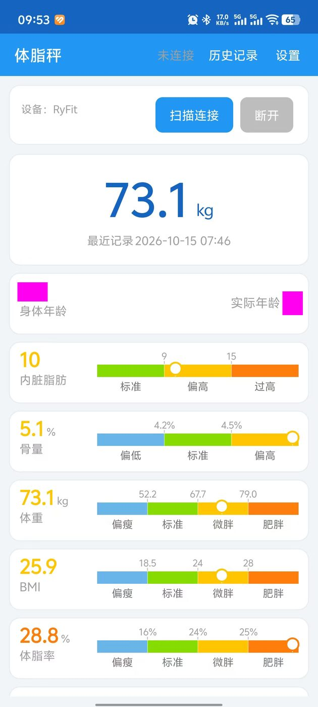
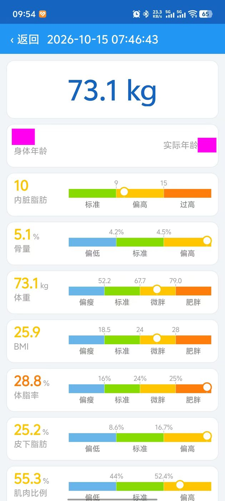
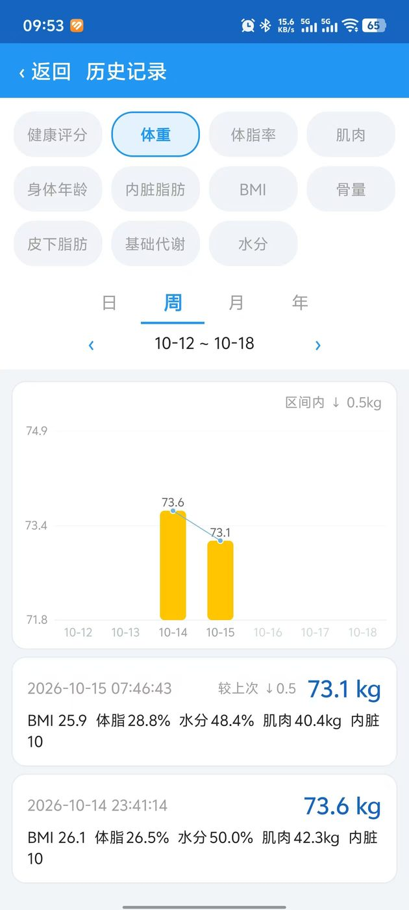
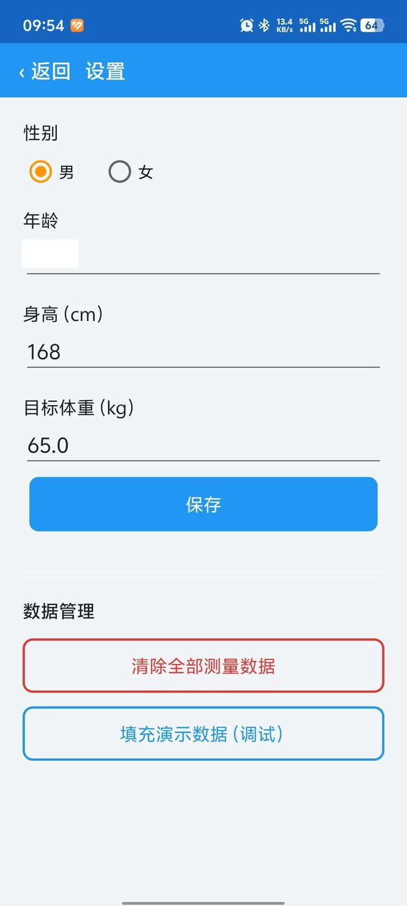

# Ryfit 体脂秤

为 **云悦（RyFit）智能体质分析仪** 等设备定制的本地化蓝牙体脂秤 Android 应用。

官方 App 依赖厂商服务器，服务器停止维护后既无法登录、也无法正常连接体脂秤。
为了让手里的秤能继续正常使用，我们逆向原厂 App 的通信协议，从零重写了这个应用：

**无账号、无服务器、无广告、无第三方 SDK** —— 不再依赖任何官方服务，
测量数据只存在你自己的手机里。

| 主页 | 测量详情 | 历史趋势 | 设置 |
| :-: | :-: | :-: | :-: |
|  |  |  |  |

## 功能

- **一键连接**：按 BLE 服务 `0000ffe0` 自动扫描并连接体脂秤（特征 `0000ffe1`），无需配对
- **实时测量**：体重实时显示，测量完成后自动解析完整身体数据并保存
- **完整身体指标**：体重、BMI、体脂率、皮下脂肪、内脏脂肪、肌肉、骨量、水分、
  基础代谢（亚洲/欧美两套标准）、身体年龄、健康评分，共 11 个维度；
  每个指标按参考区间自动分级（偏低 / 正常 / 偏高 / 过高），
  用**彩色刻度带**直观展示你当前处于哪个区间
- **历史记录**：全部测量保存在本地 SQLite，按时间倒序，点击任意一条可回看完整详情
- **趋势分析**：日（24 小时） / 周 / 月 / 年四档聚合图表，11 个维度自由切换，
  支持目标体重参考线，直观查看体重、体脂等指标的变化趋势
- **单用户**：本地保存性别 / 年龄 / 身高 / 目标体重，测量前自动写入体脂秤（游客槽位）

## 支持的设备

- 云悦（RyFit）智能体质分析仪
- 采用相同 BLE 通信协议的其他体脂秤（协议细节见下文，可自行核对）

## 构建与安装

环境要求：JDK 17+、Android SDK（build-tools 33/34、platforms android-33/34）。

```bash
# Linux / macOS
./gradlew assembleDebug

# Windows
gradlew.bat assembleDebug
```

产物：`app/build/outputs/apk/debug/app-debug.apk`（约 3.5 MB）。

安装（需开启 USB 调试）：

```bash
adb install app/build/outputs/apk/debug/app-debug.apk
```

## 数据与隐私

- 应用**没有任何网络权限**，不联网、不上传、不收集任何个人信息
- 测量记录保存在本地 SQLite（`bodyscale.db`），个人资料保存在 SharedPreferences
- 卸载应用即删除全部数据
- 蓝牙权限仅用于连接体脂秤；Android 12+ 上的扫描权限已声明 `neverForLocation`

## 通信协议（逆向自原厂 App，供校验）

- 链路：BLE 服务 `0000ffe0-0000-1000-8000-00805f9b34fb`，
  特征 `0000ffe1-0000-1000-8000-00805f9b34fb`（同一特征读写 + notify）
- 写入用户信息 `C0`：`C0 槽位 身高系数 年龄 性别`，
  身高系数 `= (身高cm - 100) / 0.5`，槽位 `09` 为游客位（单用户使用）
- 时间同步：收到 `F8` 帧后回复 `FA F8` + `(Unix秒 - 946656000)` 的 4 字节 hex 逆序
- 实时体重 `D2`：`weight = hex(das[2] + das[3]) / 10`（kg）
- 完整测量 `D0` 两帧（每帧回复 `FA D0 xx` ACK）：
  - 第一帧：时间戳 `= das[7..4] 逆序 + 946656000`；`weight = das[8,9]/10`、
    `fat = das[10,11]/10`、`water = das[12,13]/10`；BMI 本地计算
  - 第二帧：`muscle = das[4,5]/10`、`bone = das[6,7]/10`、`metabolism = das[8,9]`、
    `skinfat = das[10,11]/10`、`offalfat = das[12]`、`bodyage = das[13]`
- 派生公式：基础代谢 `370 + 21.6 × (1 - 体脂率/100) × 体重`；
  健康评分 `0.2×(100-4×内脏脂肪) + 0.3×BMI分 + 0.5×(85-(身体年龄-实际年龄)×2)`
- 本地存储：SQLite 表 `query_measurement_data`（字段沿用原 App，便于老用户迁移）

协议层已有 JVM 单元测试锁定（47 个用例通过），并已在真机验证。

## 已知限制

- 单用户（游客槽位 09），未实现原厂的多用户槽位管理
- 未实现称内历史数据的读取（B5 / C1 / D1 流程），历史记录保存在手机端
- 扫描按服务 UUID 过滤，个别设备广播命名不标准时可能搜不到

## 免责声明

- "RyFit"、"云悦" 为体脂秤设备品牌，本文档中的名称仅用于标识兼容设备
- 本应用为个人学习与使用目的开发，与原厂无任何关联，未经原厂授权
- 通信协议逆向自原厂 Android 客户端（已停止维护），仅供技术交流，请勿用于商业用途

## 许可证

[GPL-3.0](LICENSE)